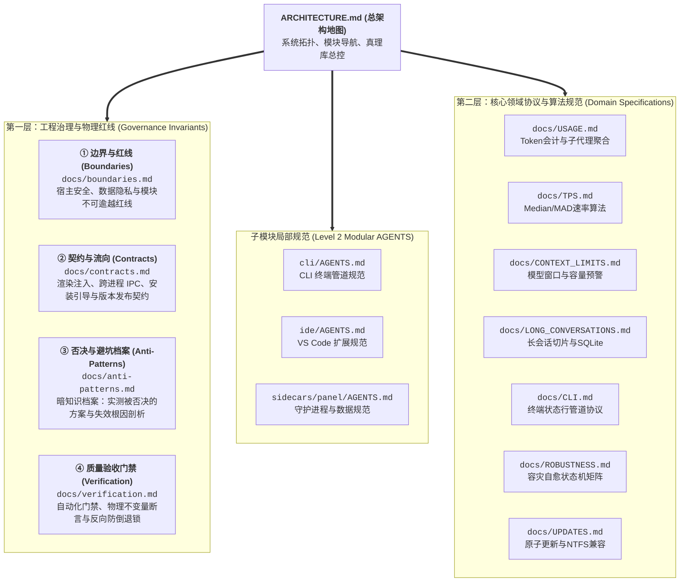
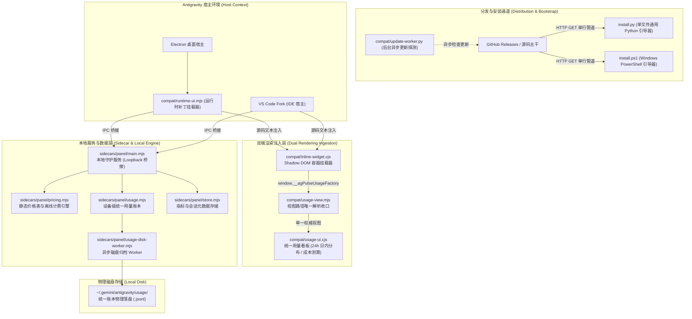

# 系统总架构指南 (System Master Architecture)

本仓库（`moumouye/antigrative-dashboard`）为主维护源，承载 Antigravity Pulse（用量分析与监控仪表板）的全链路开发、发版与治理。
核心设计遵循：**零第三方运行时依赖、宿主零侵入（严禁篡改 `app.asar`）、设备级统一账本、单脚本跨平台极简安装**。

---

## 两层工程真理体系 (Two-Tier Architecture Pyramid)

系统知识严格按两层金字塔架构分层维护：

---

## 全局系统拓扑 (System Topology)

---

## 核心文档全景地图 (Documentation Sitemap)

### 第一层：工程治理与物理红线
| 文档路径 | 核心职责 | 查阅契机 |
| :--- | :--- | :--- |
| [`docs/boundaries.md`](docs/boundaries.md) | 架构物理红线、沙箱隔离、数据隐私边界 | 涉及文件系统、外部网络、跨平台兼容性设计时 |
| [`docs/contracts.md`](docs/contracts.md) | Webview 注入协议、打包清单、安装与发布协议 | 接口调整、渲染管道变更、版本发布时 |
| [`docs/anti-patterns.md`](docs/anti-patterns.md) | 实测已否决方案、技术陷阱与失效根因记录 | 技术选型、避免重蹈覆辙时必查 |
| [`docs/verification.md`](docs/verification.md) | 质量门禁矩阵、CDP 自动化、四大物理不变量 | 任何代码提交、发版、缺陷反向断言维护前 |
| [`CHANGELOG.md`](CHANGELOG.md) | 全版本演进与发布记录 | 追溯特定版本功能特性与修复流水 |
| [`COMPATIBILITY.md`](COMPATIBILITY.md) | 跨平台系统矩阵与运行环境规范 | 查阅支持的操作系统、宿主版本与数据目录时 |

### 第二层：核心领域协议与算法规范
| 文档路径 | 核心业务领域 | 查阅契机与强绑定代码 |
| :--- | :--- | :--- |
| [`docs/TPS.md`](docs/TPS.md) | 流式输出速率算法、Median/MAD 去噪、TTFT 剥离准则 | 改动 `sidecars/panel/metrics.mjs` 时必读并同步 |
| [`docs/USAGE.md`](docs/USAGE.md) | Token 会计口径、子代理树状聚合与 Cache 命中率 | 改动 `sidecars/panel/usage.mjs` 时必读并同步 |
| [`docs/CONTEXT_LIMITS.md`](docs/CONTEXT_LIMITS.md) | Gemini 模型容量窗口、输入预算与压缩预警模型 | 改动 `sidecars/panel/pricing.mjs` 时必读并同步 |
| [`docs/LONG_CONVERSATIONS.md`](docs/LONG_CONVERSATIONS.md) | 超长会话流式分块协议、8MB 内存上限、SQLite 持久化 | 改动 `sidecars/panel/usage-disk-worker.mjs` 时必读并同步 |
| [`docs/CLI.md`](docs/CLI.md) | CLI 状态行管道协议、Argon 额度解析与 ANSI 终端输出 | 改动 `cli/*.mjs` 时必读并同步 |
| [`docs/ROBUSTNESS.md`](docs/ROBUSTNESS.md) | 跨平台容灾、网络重试与进程自愈状态机 | 调整网络超时、重连逻辑与服务生命周期时 |
| [`docs/UPDATES.md`](docs/UPDATES.md) | 应用原子更新机制、NTFS Junction 兼容与事务锁 | 改动 `sidecars/panel/updater.mjs` 时必读并同步 |
