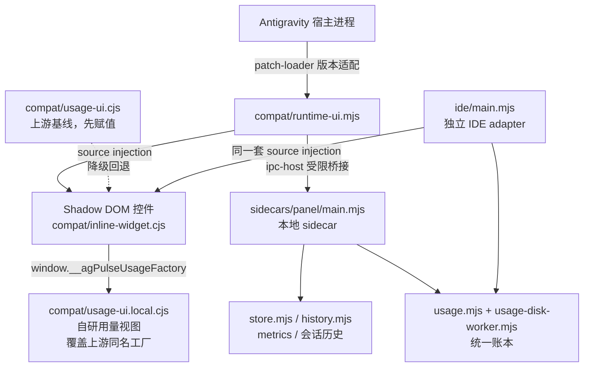

# 架构索引地图

本仓库是上游项目的二次开发分支：`upstream` 提供内核与修复，本地在其上叠加自研能力。本文件只做**索引与归属标注**，不重复描述具体实现。

## 归属约定

文件名大小写即归属标记，无需查 git 历史即可判断谁拥有该文件。

| 形态 | 归属 | 修改规则 |
| :--- | :--- | :--- |
| 全大写文件名（`USAGE.md`、`TPS.md`、`DEVELOPMENT.md`） | 上游 | 不修改；本地内容另立文件 |
| 小写文件名（`boundaries.md`、`contracts.md`） | 本地 | 本地唯一真相，覆盖式维护 |
| 其余一切源文件 | 上游 | 改动前先查 [`docs/boundaries.md`](docs/boundaries.md) 的分区 |

## 系统拓扑

## 文档地图

| 文件 | 归属 | 职责 | 何时读 |
| :--- | :--- | :--- | :--- |
| [`docs/DEVELOPMENT.md`](docs/DEVELOPMENT.md) | 上游 | 目录结构、测试命令、数据边界 | 每次动手前 |
| [`docs/ROBUSTNESS.md`](docs/ROBUSTNESS.md) | 上游 | 更新与恢复的故障矩阵 | 改更新链路 |
| [`docs/USAGE.md`](docs/USAGE.md) | 上游 | 本地 token 统计口径 | 改统计口径 |
| [`docs/UPDATES.md`](docs/UPDATES.md) | 上游 | 手动更新流程 | 改 updater |
| [`docs/TPS.md`](docs/TPS.md) | 上游 | TPS 计时质量定义 | 改速率计算 |
| [`docs/CONTEXT_LIMITS.md`](docs/CONTEXT_LIMITS.md) | 上游 | 上下文占用与压缩 | 改上下文控件 |
| [`docs/CLI.md`](docs/CLI.md) | 上游 | CLI 状态行 | 改 cli/ |
| [`docs/LONG_CONVERSATIONS.md`](docs/LONG_CONVERSATIONS.md) | 上游 | 长对话采集 | 改 transcript |
| [`docs/boundaries.md`](docs/boundaries.md) | 本地 | 上游漂移边界与禁改区 | 决定改哪里之前 |
| [`docs/contracts.md`](docs/contracts.md) | 本地 | 本地与上游的接口契约 | 改注入点、打包、版本 |
| [`docs/anti-patterns.md`](docs/anti-patterns.md) | 本地 | 已否决方案与失效根因 | 想动结构时 |
| [`docs/verification.md`](docs/verification.md) | 本地 | 门禁矩阵与基线数字 | 提交前 |
| [`docs/LOCAL_CHANGES.md`](docs/LOCAL_CHANGES.md) | 本地 | 本地变更流水 | 追溯为什么有这处改动 |

## 文档引用规则

本地文档可以引用上游文档；上游文档不得引用本地文档。上游对文件执行覆盖式改写，反向引用必然断链。`ARCHITECTURE.md` 与 `AGENTS.md` 是唯一允许同时指向两侧的汇合点。

事实只有一个出处：上游已描述的结构、测试命令、数据边界，本地文档只写指针与增量差值，不复制正文。
