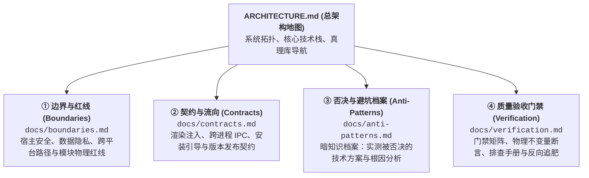
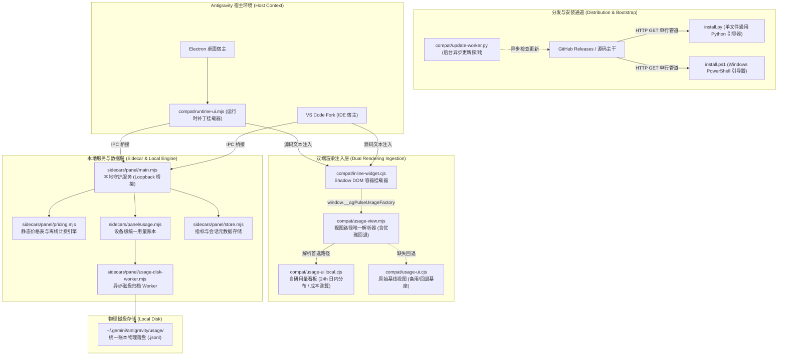

# 系统总架构指南 (System Master Architecture)

本仓库（`moumouye/antigrative-dashboard`）为主维护源，承载 Antigravity Pulse（用量分析与监控仪表板）的全链路开发、发版与治理。
核心设计遵循：**零第三方运行时依赖、宿主零侵入（严禁篡改 `app.asar`）、设备级统一账本、单脚本跨平台极简安装**。

---

## 四维工程真理库 (The 4 Pillars of Architecture)

系统架构知识严格按四维真理库进行分治维护，在执行不同开发与维护任务时按需调阅专述文档：

### 1. [① 边界与红线 (docs/boundaries.md)](docs/boundaries.md)
* **适用场景**：模块设计、涉及宿主注入、改动文件系统持久化或增加跨平台逻辑时必读；
* **核心内容**：宿主完整性保护（零侵入 ASAR）、本地环回与隐私安全、零外部依赖红线、模块分工边界。

### 2. [② 契约与流向 (docs/contracts.md)](docs/contracts.md)
* **适用场景**：修改视图加载、跨进程 IPC 协议、安装打包逻辑或发布新版本时必读；
* **核心内容**：Webview 源码注入契约、单脚本安装引导契约、多文件版本同步契约、文本模式发布契约。

### 3. [③ 否决与避坑档案 (docs/anti-patterns.md)](docs/anti-patterns.md)
* **适用场景**：技术选型重构、排查疑难 Bug、准备引入构建工具或调整目录时必读；
* **核心内容**：TS 迁移陷阱 (AP-001)、直接改写基线文件 (AP-002)、平行体系污染 (AP-003)、失效源依赖 (AP-008)、发布空包断言崩溃 (AP-009) 等实测废案。

### 4. [④ 质量验收门禁 (docs/verification.md)](docs/verification.md)
* **适用场景**：完成代码修改、准备提交 PR/Release、验证反向防倒退断言时必读；
* **核心内容**：本地门禁执行命令（`tools/local-gate.mjs`）、CDP 无头走查、四大物理不变量断言标准。

---

## 全局系统拓扑 (System Topology)

---

## 核心文档地图 (Documentation Sitemap)

| 文档路径 | 核心职责 | 查阅契机 |
| :--- | :--- | :--- |
| [`docs/boundaries.md`](docs/boundaries.md) | 架构物理红线、沙箱隔离、数据隐私边界 | 涉及文件系统、外部网络、跨平台兼容性设计时 |
| [`docs/contracts.md`](docs/contracts.md) | Webview 注入协议、打包清单、安装与发布协议 | 接口调整、渲染管道变更、版本发布时 |
| [`docs/anti-patterns.md`](docs/anti-patterns.md) | 实测已否决方案、技术陷阱与失效根因记录 | 技术选型、避免重蹈覆辙时必查 |
| [`docs/verification.md`](docs/verification.md) | 质量门禁矩阵、CDP 自动化、四大物理不变量 | 任何代码提交、发版、缺陷反向断言追肥前 |
| [`docs/LOCAL_CHANGES.md`](docs/LOCAL_CHANGES.md) | 架构演进与自研功能里程碑流水 | 追溯特定功能实现背景与架构决策历史 |
| [`docs/DEVELOPMENT.md`](docs/DEVELOPMENT.md) | 基础工程目录全景、原生环境要求与核心测试规范 | 初次进入项目开发、了解全量目录结构时 |
| [`docs/ROBUSTNESS.md`](docs/ROBUSTNESS.md) | 进程生命周期、故障恢复与降级容灾矩阵 | 涉及服务重启、异常崩溃防御设计时 |
| [`docs/USAGE.md`](docs/USAGE.md) | Token 统计口径、会话采样定义与数据结构 | 调整计费口径、Token 解析规则时 |
| [`docs/TPS.md`](docs/TPS.md) | Token 输出速率与耗时统计算法规范 | 调整实时速率展示与计时平滑算法时 |
| [`docs/CONTEXT_LIMITS.md`](docs/CONTEXT_LIMITS.md) | 模型上下文窗口阈值与预警标准 | 涉及上下文超限警告、容量进度条展示时 |
| [`docs/CLI.md`](docs/CLI.md) | CLI 状态行与轻量终端展示规范 | 调整命令行交互与状态指示时 |
| [`docs/LONG_CONVERSATIONS.md`](docs/LONG_CONVERSATIONS.md) | 超长会话轨迹采集与分块落盘协议 | 处理多轮复杂交互轨迹解析与存储时 |
