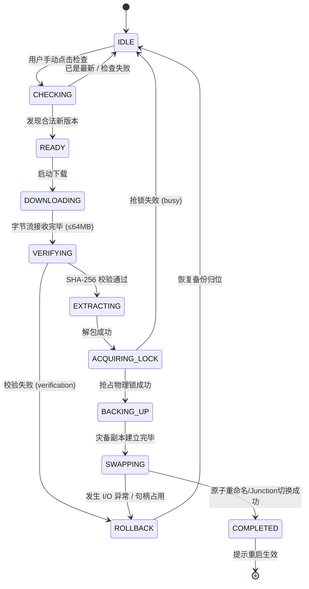

# 应用更新与容灾状态机规范 (App Updates & Disaster Recovery Spec)

本文档定义 Antigravity Pulse（App 端）在线更新状态机、Windows NTFS 目录联接（Junction）兼容协议、跨进程生命周期锁与原子灾备回滚规范。
代码实现（`sidecars/panel/updater.mjs`、`compat/update-worker.py`、`compat/update-lock.py`）必须严格遵循本文档的状态转移矩阵与物理红线。

---

## 1. 业务目标与物理不变量 (Context & Invariants)

* **领域核心目标**：提供确定性、断电防毁、零网络污染的插件自身平滑原子更新能力；
* **物理与范围不变量 (Invariants)**：
  1. **严格限定更新范围**：本更新器**仅更新 Antigravity Pulse App 插件自身**；严禁更新 IDE 插件、CLI 适配器、宿主 Electron 核心或修改用户账号配置；
  2. **跨进程互斥排他锁 (Single-Writer Invariant)**：同一时刻全机仅允许一个生命周期操作（安装/更新/卸载/回滚）执行，通过操作系统级非阻塞锁锁定 `.antigravity-pulse-update.lock`，**严禁使用文件软链接或删除锁文件（Unlink）**；
  3. **事务原子性与不可破坏性**：新包在临时沙箱完整校验 SHA-256 并生成灾备备份前，严禁覆盖既有运行目录；失败必须无损回滚。

---

## 2. 更新生命周期有限状态机 (Lifecycle State Machine Matrix)

更新流程严格由受限的状态机驱动，任何未列出的状态跃迁均被物理阻断：

### 状态转移与异常守卫矩阵

| 当前状态 (State) | 触发事件 (Event) | 守卫断言 (Guard Condition) | 目标状态 (Next State) | 副作用动作 (Action) |
| :--- | :--- | :--- | :--- | :--- |
| `IDLE` | 手动触发检查 | 距离上次计划 $<15\text{ min}$ | `CHECKING` | 启动受限 Python Worker 查询 GitHub API |
| `CHECKING` | 收到 Release 元数据 | 包含合法 zip 与 sha256 且版本高于当前 | `READY` | 缓存计划元数据 (15分钟有效窗口) |
| `READY` | 用户确认更新 | 计划未过期 ($t - t_0 < 900\text{ s}$) | `DOWNLOADING` | 流式拉取安装包并上报进度 (`received/total`) |
| `DOWNLOADING` | 下载完成 | 文件大小 $\le 64\text{ MiB}$ 且网络无中断 | `VERIFYING` | 提取预期哈希比对实际 SHA-256 |
| `VERIFYING` | 哈希校验完成 | `actualSha256 === expectedSha256` | `EXTRACTING` | 解压至隔离的 `.antigravity-pulse-staging` 目录 |
| `EXTRACTING` | 解包完成 | 包含白名单清单所必需的核心模块文件 | `ACQUIRING_LOCK` | 执行 `lifecycle_lock` 抢占排他锁 |
| `ACQUIRING_LOCK` | 操作系统加锁 | Windows `msvcrt.locking` / POSIX `flock` 成功 | `BACKING_UP` | 将当前运行目录快照备份至外部目录 |
| `BACKING_UP` | 备份完成 | 备份目录不在插件源码子树内 | `SWAPPING` | 执行 Windows 目录句柄释放并原子替换目录 |
| `SWAPPING` | 目录替换成功 | 物理目录存在且入口模块可读 | `COMPLETED` | 清理临时沙箱，写入成功标记 |
| `* (任意状态)` | 捕获不可恢复异常 | 触发任意错误（I/O、权限、进程中断） | `ROLLBACK` | 从备份目录原子复原，清理锁状态 |

---

## 3. Windows NTFS 目录联接与句柄释放协议 (Junctions & Handle Release)

针对用户重定向系统目录（如 `%USERPROFILE%\.gemini` 为 NTFS Junction 挂载至其他磁盘）的物理环境，必须遵守以下契约：

1. **权威物理路径解析**：
   - 更新器解析物理真实路径（`physical path`），严禁在更新日志和事务记录中混淆逻辑与物理路径；
   - 插件根目录、备份目录与事务锁必须绑定至解析后的实体磁盘节点。
2. **Windows 进程当前目录句柄释放 (`releaseRuntimeDirectory`)**：
   - 在 Windows 环境下，Node.js / Electron 进程如果以 `assets/`、`compat/` 或 `sidecars/` 作为工作目录（CWD），Windows 内核将对该目录施加共享锁，导致原子重命名报 `EPERM / EACCES`；
   - **强制行为**：在执行重命名前，必须调用 `releaseRuntimeDirectory(pluginDir)` 将进程 CWD 切换回上层根目录，释放目录占用句柄。
3. **跨进程锁防重入铁律 (`update-lock.py`)**：
   - 锁文件路径：`Path(target).parent / '.antigravity-pulse-update.lock'`；
   - 严禁对软链接或重定向文件加锁（`linked(path) -> raise ValueError`）；
   - **严禁删除锁文件 (Never Unlink)**：删除并重建已被锁定的 Inode 会放行第二个写入者，造成双写死锁；锁的释放只能通过文件描述符 `close` 触发内核自动释放。

---

## 4. 故障矩阵与错误码映射表 (Fault Recovery Matrix)

| 故障类别 (`code`) | 详细原因 (`detail`) | 侦测机制 | 强制处置动作 |
| :--- | :--- | :--- | :--- |
| **`python`** | `python-missing` / `python-version` | 启动前探测探针，需 Python $\ge 3.10$ | 阻断流程，提示安装或升级 Python 运行时 |
| **`network`** | `timeout` / `dns` / `proxy` / `http` | 下载过程中 Socket 异常或 HTTP 4xx/5xx | 保持旧版本不动，提示网络重试，不污染磁盘 |
| **`busy`** | `permission` / 锁冲突 | `lifecycle_lock` 抛出 `FileExistsError` | 立即退出，避免与正在运行的安装/卸载冲突 |
| **`verification`**| 哈希不匹配 | SHA-256 比对失败 | 删除损坏的 staging 临时文件，终止更新 |
| **`location`** | `install-location` | 检测到受控目录下包含非法软链接嵌套 | 拒绝更新，保护用户数据不被非受控篡改 |

---

## 5. 机械化断言与测试防线 (Verification Contract)

* **关联自动化测试套件**：
  - [`tests/test_update_junctions.py`](file:///Users/yemou/Documents/extentions/antigrative-dashboard/tests/test_update_junctions.py)（Windows NTFS 联接与物理路径解析测试）
  - [`tests/test_update_files.py`](file:///Users/yemou/Documents/extentions/antigrative-dashboard/tests/test_update_files.py)（文件原子重命名与替换测试）
  - [`tests/test_update_network.py`](file:///Users/yemou/Documents/extentions/antigrative-dashboard/tests/test_update_network.py)（网络超时与代理故障降级测试）
  - [`tests/test_update_worker.py`](file:///Users/yemou/Documents/extentions/antigrative-dashboard/tests/test_update_worker.py)（Worker 进程间通信与异常阻断测试）
* **核心活体防倒退反向断言**：
  1. `junction target resolution identifies physical destination correctly`（精准识别 NTFS 联接物理目标）；
  2. `releasing runtime directory unblocks directory rename on Windows`（释放工作目录句柄彻底消除 EPERM）；
  3. `corrupted download triggers immediate verification abort without touching runtime`（损坏包物理阻断）；
  4. `active lock strictly rejects second concurrent updater process`（并发更新双写绝对互斥）。
