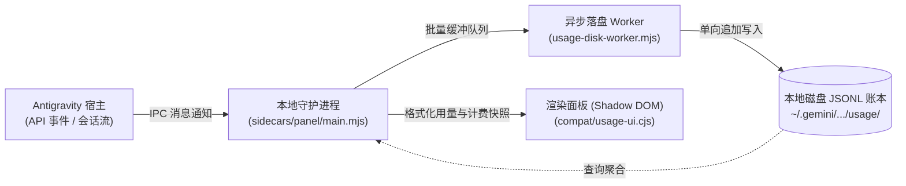
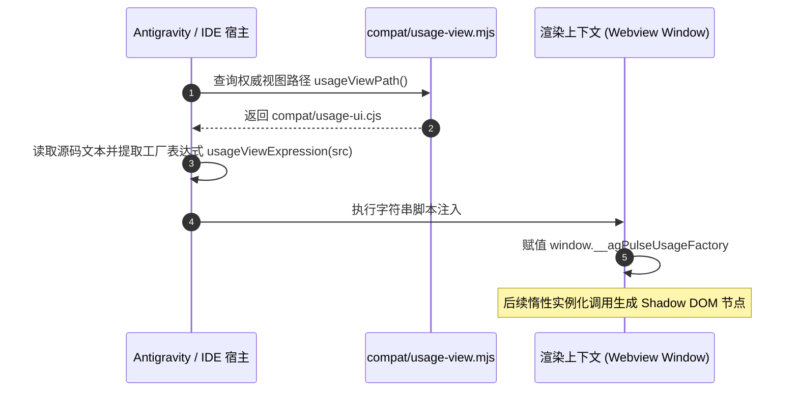
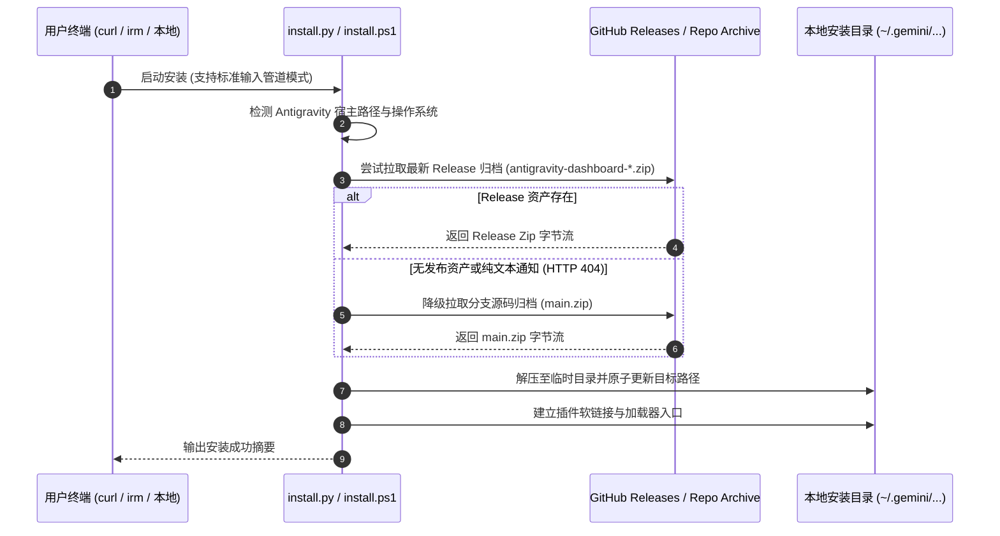

# ② 契约与流向 (Contracts & Data Pipelines)

本文档定义系统的端到端数据流向、跨进程通信时序、渲染注入协议、单文件安装引导契约与发布版本同步契约。

---

## 1. 全局数据流向管道 (Data Flow Architecture)

系统以**本地设备级统一账本**为单一事实源，通过单向数据流与异步 Worker 实现零阻塞高吞吐流转：



---

## 2. 渲染层源码注入契约 (Rendering Ingestion Contract)

`compat/*.cjs` 不是通过标准 Node.js `import` 或 `require` 加载，而是在运行时被宿主读为**纯源码文本**，经清洗后直接注入 Webview 运行上下文中。



### 统一路径解析器契约
视图文件的物理寻址必须唯一调用 `compat/usage-view.mjs`，严禁任何消费者自行拼接路径：

```js
// compat/usage-view.mjs
export function usageViewPath() {
  return join(here, 'usage-ui.cjs');
}
export function usageViewExpression(source) {
  // 提取 module.exports = 后的单个函数或类表达式文本
}
```

### 管道约束
1. **导出单一性**：被注入的 `.cjs` 必须有且仅有一处 `module.exports = `，其后必须是单个匿名函数或类表达式；
2. **全局命名空间隔离**：跨文件工厂通信严格遵循 `window.__agPulse*Factory` 命名空间约定；
3. **单轨注入收口**：App 与 IDE 管道统一接入 `compat/usage-ui.cjs`，彻底消除多文件版本分叉；
4. **惰性消费**：UI 挂载点在宿主渲染准备就绪后惰性调用 `window.__agPulseUsageFactory({ root, language, ... })`，工厂晚于挂载点定义是安全的。

---

## 3. 安装与引导器契约 (Installer & Bootstrap Contract)

安装程序（`install.py` / `install.ps1`）承载跨平台一键部署，必须保证在全新裸机上无需前置环境即可运行：



### 引导程序物理契约
1. **无外部依赖**：仅使用 Python 3 标准库（`urllib.request`, `zipfile`, `shutil`）或 Windows 原生 PowerShell；
2. **双模执行支持**：
   - 管道模式：`curl -fsSL .../install.py | python3`（或 `irm .../install.ps1 | iex`），无本地预存文件；
   - 本地模式：`python3 install.py`，优先使用同目录现有文件，离线自闭环；
3. **容灾降级规则**：当 GitHub Release 未附加 `.zip` 二进制资产时，自动透明回退至 `main.zip` 分支源码包，杜绝因发版形态变更导致安装中断。

---

## 4. 版本发布契约 (Release Publication Contract)

### 三处版本号确定性同步
版本号推进时，以下三个清单文件中的 `version` 字段必须保持绝对一致：

```text
package.json      --> "version": "X.Y.Z"
plugin.json       --> "version": "X.Y.Z"
ide/package.json  --> "version": "X.Y.Z"
```

### 发布模式双轨契约 (`tools/publish-release.py`)
发布脚本提供两种标准化发布模式：

| 模式 | 触发命令 | 适用场景 | 资产校验行为 |
| :--- | :--- | :--- | :--- |
| **标准完整发布** | `python tools/publish-release.py` | 携带打包产物的完整分发 | 严格校验 `dist/antigravity-dashboard-*.zip` 与 VSIX 存在，全量上传 |
| **纯文本通知发布** | `python tools/publish-release.py --text-only` | 仅推送更新日志与版本通知 | **跳过所有二进制资产检查**，直接发布 GitHub Release 正文，不上传附件 |

---

## 5. 打包白名单契约 (Packaging Whitelist Contract)

发行包构建严格采用显式白名单机制。新增的文件若未在以下清单中登记，发布包中将不会包含该文件：

| 配置位置 | 约束对象 | 白名单形式 |
| :--- | :--- | :--- |
| `ide/package.py:10-14` | VSIX 扩展包 | `MODULES = [...]` 硬编码路径数组 |
| `manage.py:DIST_FILES` | 桌面端分发 Zip | `DIST_FILES = [...]` 字典列举 |
| `tools/check-update-cwd.mjs` | 更新链路校验 | 完整性文件清单校验 |

---

## 6. 测试与门禁执行契约 (Testing & Gate Contract)

| 门禁层级 | 契约命令 | 依赖条件 | 断言目标 |
| :--- | :--- | :--- | :--- |
| **Node.js 单元测试** | `npm test` | 无（原生 Node.js test runner） | 覆盖 `sidecars/panel/tests/`, `cli/tests/`, `ide/tests/` |
| **Python 宿主测试** | `python3 -m unittest discover -s tests` | 无（Python 3 标准 unittest） | 覆盖生命周期、安装器、路径解析 |
| **真实用量 CDP 门禁** | `node tools/check-usage-ui-cdp.mjs` | 本地安装的 Chrome / Chromium | 直连系统 Chrome CDP 端口，端到端验证用量渲染无运行时报错 |
| **本地统一门禁入口** | `node tools/local-gate.mjs` | 零第三方依赖 | 串联上述三道硬门禁，退出码 0 为唯一通过标准 |
